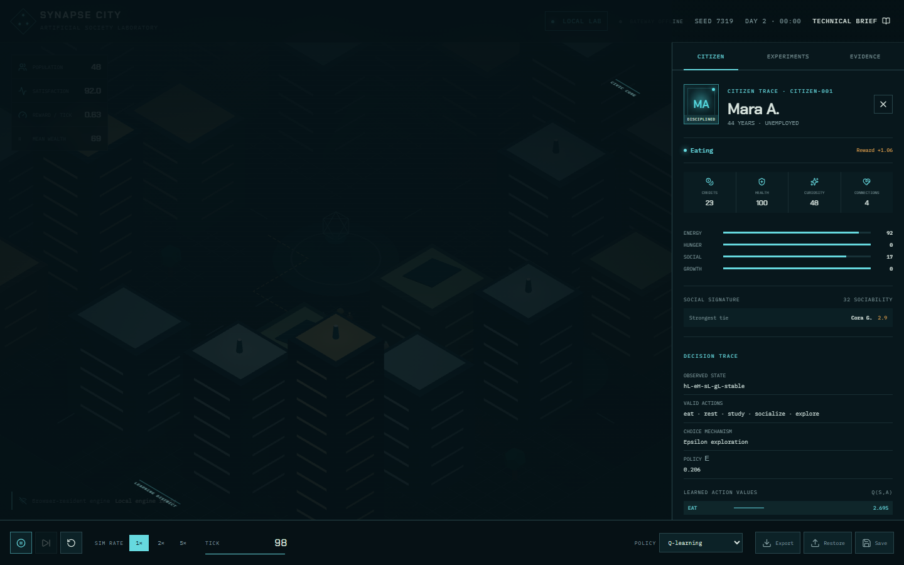

# SYNAPSE CITY

**An Artificial Society That Learns** — a browser-first, deterministic multi-agent city built as an inspectable reinforcement-learning laboratory.

SYNAPSE CITY is designed for two audiences at once: visitors can explore a cinematic 3D miniature city immediately, while technical reviewers can inspect the exact state, valid actions, utility scores, Q-values, reward, and transition behind each citizen decision.

> Portuguese summary: uma cidade artificial 3D em que agentes autônomos tomam decisões a partir de necessidades, restrições e Q-learning tabular. A simulação principal roda em Web Worker e continua funcionando mesmo quando o backend gratuito está suspenso.

## Live services

- Frontend: https://synapse-city-taupe.vercel.app
- API: deployment URL is written here after Render validation.
- Technical brief: `/technical` on the frontend deployment.



## What is actually implemented

- Seeded, serializable PRNG and discrete deterministic ticks.
- 48 autonomous citizens with individual needs, money, food, health, stress, traits, memory, relationships, profession, and Q-table.
- Six constrained actions: work, eat, rest, study, socialize, and explore.
- Hybrid utility/Q-learning policy with epsilon-greedy exploration and decay.
- Real Q-value updates and an on-screen Decision Trace.
- Closed money transfers between citizens and the city treasury; stock and affordability constraints.
- Dynamic social ties from actual interaction actions.
- Grid A* routes around procedural building footprints, with continuous waypoint movement.
- Four controlled interventions with an auditable event log.
- Random-valid, need-heuristic, and trained-policy headless comparison.
- Versioned JSON export/import and browser checkpoints.
- Procedural React Three Fiber city with adaptive quality and touch camera controls.
- Mobile-specific bottom laboratory drawer and safe-area-aware controls.
- FastAPI health/session gateway with validation, isolation, TTLs, CORS, rate limiting, and WebSocket heartbeat.
- CI for lint, type checking, engine tests, frontend build, and API tests.

## What is algorithm, heuristic, and visualization

| Layer | Role |
|---|---|
| Tabular Q-learning | Learns state-action values from observed reward transitions. |
| Need utility | Safe prior for unseen states and the standalone heuristic baseline. |
| Epsilon-greedy | Controlled exploration; decays during the live simulation. |
| Reward function | Weighted change in wellbeing plus valid economic/social outcomes and health penalties. |
| Three.js city | Visualization only. It never chooses actions or manufactures metrics. |
| FastAPI gateway | Optional infrastructure surface; the canonical engine remains local. |

## Measured evidence

The current held-out evaluation runs four seeds for each policy. Q-learning trains for 1,800 ticks on separate shifted seeds before evaluation.

| Policy | Satisfaction | Reward/tick | Hunger |
|---|---:|---:|---:|
| Valid random | 75.27 | 0.395 | 63.19 |
| Need heuristic | **85.00** | **0.485** | **33.22** |
| Q-learning | 76.13 | 0.470 | 66.42 |

The learned policy beat random-valid behavior on satisfaction and reward, but did not beat the specialized heuristic and performed worse on hunger. That result is intentionally exposed. See [experiment methodology](docs/experiments/methodology.md) and the [measured benchmark](docs/benchmarks/2026-10-10.md).

## Repository layout

```text
apps/web/                  Next.js UI, Web Worker, Three.js scene, Playwright
packages/simulation/       Framework-independent engine, learning, A*, tests
services/simulation-api/   FastAPI session gateway and tests
docs/                      Architecture, experiments, benchmarks, screenshots
.github/workflows/         CI pipeline
render.yaml                Native Python Render Blueprint (no Docker)
```

The component and tick diagrams are in [docs/architecture/overview.md](docs/architecture/overview.md).

## Run locally — no Docker

Requirements: Node.js 22+ and Python 3.12+ for the optional gateway.

```bash
npm --prefix packages/simulation install
npm --prefix apps/web install
npm --prefix apps/web run dev
```

Open `http://localhost:3000`. The city does not require the API.

Optional API:

```bash
cd services/simulation-api
python -m venv .venv
.venv/Scripts/pip install -r requirements.txt
.venv/Scripts/uvicorn app.main:app --reload
```

## Tests and experiments

```bash
npm --prefix packages/simulation test
npm --prefix packages/simulation run typecheck
npm --prefix packages/simulation run benchmark
npm --prefix apps/web run lint
npm --prefix apps/web run typecheck
npm --prefix apps/web run build
npm --prefix apps/web run test:e2e
python -m pytest services/simulation-api/tests
```

The automated suite covers deterministic replay, snapshot round-trip, need and resource bounds, transaction constraints, Q updates, seeded exploration, policy evaluation, relationships, intervention audit, A* collision avoidance, API health, input validation, isolated sessions, desktop Chromium, and Pixel 7 flows.

## Known limitations

- The public FastAPI deployment is a session gateway, not a duplicate simulation runtime. Local Lab is the canonical mode.
- Cloud snapshot persistence is not enabled; saves are browser-local or exported JSON.
- The economy is a bounded artificial model, not a macroeconomic simulator.
- A* uses a fixed grid and building footprints; dynamic crowd avoidance is visual rather than a full reciprocal-velocity solver.
- The trained table currently trails the purpose-built heuristic. More state features or multi-objective reward tuning require new controlled measurements.
- The 3D scene uses procedural geometry rather than authored character animation assets to keep startup and mobile GPU cost bounded.

## Security notes

No AI key is required. The browser never receives server secrets. Snapshot schemas are checked before restoration, the public gateway validates payload sizes and ranges, session identifiers are random, sessions expire, CORS is restricted, and no user-supplied code is evaluated.

## License

MIT — see [LICENSE](LICENSE).
