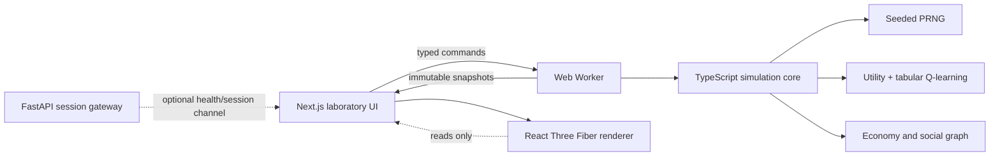
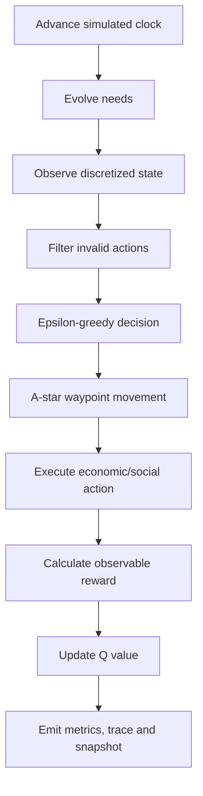

# Architecture

SYNAPSE CITY treats the simulation as a domain library, not as a React feature. `packages/simulation` has no dependency on the browser, React, Three.js, or wall-clock time.

## Tick lifecycle

## Trade-offs

- Browser-first execution keeps the public demo available during backend cold starts.
- A small tabular learner is explainable and testable; deep RL would add cost without demonstrated value for this state space.
- The FastAPI service is intentionally a session gateway today. It does not pretend to run a second, divergent Python simulation.
- JSON snapshots are schema-versioned and validated before restoration. Cloud persistence is not advertised.
